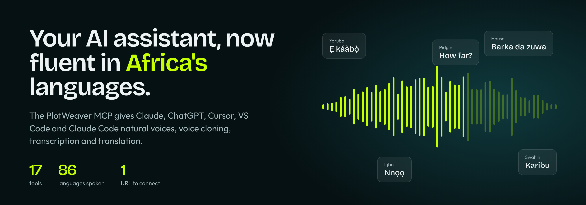
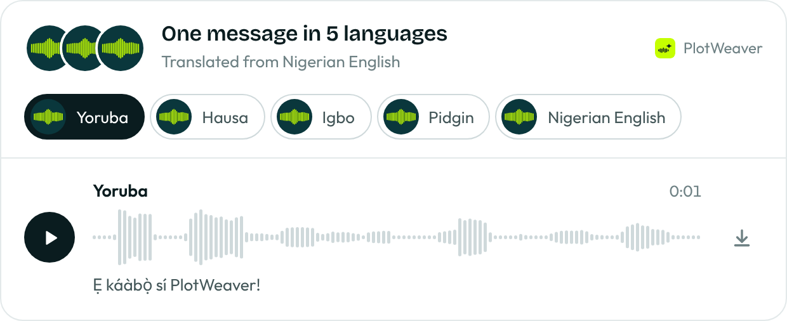
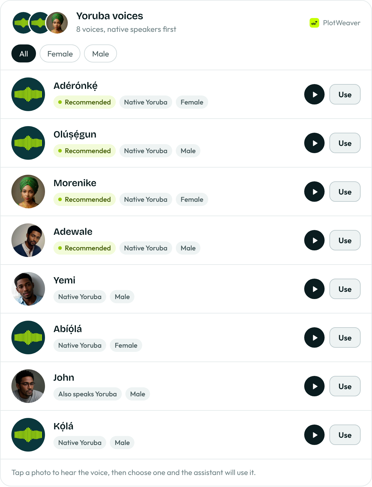

<p align="center">
  
</p>

<h1 align="center">PlotWeaver MCP</h1>

<p align="center">
  Natural speech, voice cloning, transcription and translation for Nigerian and African languages,<br>
  inside Claude, ChatGPT, Claude Code, Cursor, VS Code and any MCP client.
</p>

<p align="center">
  <a href="https://plotweaver.mintlify.app/mcp/overview"><b>Documentation</b></a> ·
  <a href="docs/tools.md"><b>Tools</b></a> ·
  <a href="docs/prompts.md"><b>Example prompts</b></a> ·
  <a href="https://app.plotweaver.app"><b>Get an account</b></a>
</p>

---

```
https://mcp.plotweaver.app/mcp
```

That one address is the whole setup. A remote MCP server over Streamable HTTP: nothing to install, nothing to run, nothing to keep updated. Add it to your assistant, sign in with your PlotWeaver account, and ask in plain words.

> Make a Yoruba voiceover for my product video, one clip per scene.

> Subtitle this Hausa interview in English.

> Say our welcome message in Yoruba, Hausa, Igbo, Pidgin and English.

<p align="center">
  
</p>

## Connect in under a minute

| App | How | Guide |
|---|---|---|
| **Claude** (web, desktop, mobile) | **Customize > Connectors > + Add > Add custom connector**, paste the URL, sign in | [docs/claude.md](docs/claude.md) |
| **ChatGPT** | **chatgpt.com/plugins > + > Add custom MCP server**, paste the URL, choose OAuth | [docs/chatgpt.md](docs/chatgpt.md) |
| **Claude Code** | `claude mcp add --transport http --scope user plotweaver https://mcp.plotweaver.app/mcp`, then `/mcp` | [docs/claude-code.md](docs/claude-code.md) |
| **Cursor** | Add the server to `~/.cursor/mcp.json` | [docs/cursor.md](docs/cursor.md) |
| **VS Code** | Add the server to `.vscode/mcp.json`, use Agent mode | [docs/vscode.md](docs/vscode.md) |
| **Windsurf, any MCP client, the Claude and OpenAI APIs** | URL plus an `X-API-Key` header | [docs/other-clients.md](docs/other-clients.md) |

Ready-to-copy configuration files are in [`examples/`](examples).

## What your assistant can do

| | |
|---|---|
| **Speak** | Voiceovers, narration, ads and announcements in 86 languages, from one line to a whole script, one file per scene, each with its exact duration |
| **Hold conversations** | Scripts with several speakers, each in their own voice, mixed into one file with a timeline of every line |
| **Speak five languages at once** | Translate one message and voice it in English, Yoruba, Hausa, Igbo and Nigerian Pidgin |
| **Transcribe and subtitle** | Audio or video of any length with STORM ASR 2.0, including speech that mixes languages, with timed segments and optional translation |
| **Translate** | Between English, Yoruba, Hausa, Igbo and Nigerian Pidgin |
| **Clone a voice** | From a few seconds of one person, with the speaker's permission collected on a recording page |
| **Read documents aloud** | Web pages, PDFs and Word files turned into speech |
| **Keep you in control** | Prices a job before running it, shows your usage, and asks before deleting anything |

In Claude, ChatGPT and VS Code, results play right in the chat, and `find_voices` opens a gallery of voices you can listen to and pick from.

<p align="center">
  
</p>

## The voices

**69 native Nigerian voices** on STORM v1.5, 41 female and 28 male, each a native speaker of Yoruba, Hausa, Igbo, Nigerian Pidgin or Nigerian English, and every one able to speak all five. Voices for **81 more African languages** on STORM Ensemble 3.0 and STORM v3, from Swahili, Amharic and Zulu to Ghanaian languages such as Buli, Kusaal and Konkomba that no other model speaks.

Voices you clone in a Nigerian language speak all five Nigerian languages too.

## The tools

17 tools, each labelled so your assistant knows what only reads, what spends credit and what deletes.

| Tool | What it does | Kind |
|---|---|---|
| `speak` | Text to speech, any length, or many segments at once (one file each) | Spends credit |
| `speak_in_languages` | Translate one text and voice it in several Nigerian languages | Spends credit |
| `create_dialogue` | A script with several speakers to one audio file, with a timeline | Spends credit |
| `transcribe_audio` | Speech to text from audio or video, any length, optional translation | Spends credit |
| `translate_text` | Translation between `en`, `yo`, `ha`, `ig` and `pcm` | Spends credit |
| `clone_voice` | Save a cloned voice from a short recording, with consent | Spends credit |
| `find_voices` | Voices for a language, with playable samples | Read only |
| `get_voice` | One voice's details and samples | Read only |
| `rename_voice` | Rename a cloned voice | Changes data |
| `delete_voice` | Delete a cloned voice | Destructive, asks first |
| `upload_file` | A one-time link the assistant sends a file to from its own workspace | Free |
| `record_voice` | A one-time page to record or upload audio from a phone or computer | Free |
| `read_document` | The readable text of a web page, PDF, Word or text file | Free |
| `get_audio` | A fresh link to audio made earlier | Read only |
| `list_languages` | Every language and what it supports | Read only |
| `estimate_cost` | Price a job before running it | Read only |
| `get_account` | Usage and cost per service | Read only |

Full inputs and behaviour: [docs/tools.md](docs/tools.md).

## How files move

Assistants with their own workspace (Claude, Claude Code, Cursor and any agent with a shell) send your files to PlotWeaver directly with `upload_file`, so you never upload anything twice. For a voice only you have, `record_voice` gives you a one-time page to record on from your phone. Every result comes back with an `audio_id`, a download link that works for 24 hours, and its exact duration. Details: [docs/files-and-audio.md](docs/files-and-audio.md).

## Security

- **Sign in with PlotWeaver** is standard MCP OAuth 2.1 with PKCE. The app never sees your API key: it gets a short-lived token that works only with this server.
- Each connection appears in your dashboard as its own key ("Claude connector", "ChatGPT connector"). Delete it and that app is disconnected everywhere, at once.
- Apps other than Claude and ChatGPT are clearly marked as unverified on the sign-in page, with their address.
- Text from documents and transcripts reaches your assistant as content, never as instructions.

More: [docs/sign-in-and-security.md](docs/sign-in-and-security.md) · [SECURITY.md](SECURITY.md)

## Pricing

Every request runs on your own PlotWeaver account at your normal rates, exactly like an API call, with one pool of minutes for every service. See [plotweaver.app/pricing](https://plotweaver.app/pricing). Ask your assistant to "estimate the cost first" before a large job.

## For AI coding agents

Drop [`AGENTS.md`](AGENTS.md) into your project and your coding agent will know how to use PlotWeaver well: which voice suits which language, how to send files, and how to keep costs in check.

## Documentation

| | |
|---|---|
| [Example prompts](docs/prompts.md) | What to ask, and what happens behind each request |
| [Tools reference](docs/tools.md) | All 17 tools and their inputs |
| [Files and audio](docs/files-and-audio.md) | Uploads, recordings, links and how long things are kept |
| [Sign-in and security](docs/sign-in-and-security.md) | What happens when you connect an app |
| [Troubleshooting](docs/troubleshooting.md) | Fixes for the common problems |
| [Developer API docs](https://plotweaver.mintlify.app) | Building PlotWeaver into your own product |

## Registry

Listed in the [official MCP Registry](https://registry.modelcontextprotocol.io) as `app.plotweaver.mcp/plotweaver`. See [`server.json`](server.json).

## Support

[info@plotweaver.app](mailto:info@plotweaver.app) · [x.com/plotweaverapp](https://x.com/plotweaverapp) · [linkedin.com/company/plotweaver](https://www.linkedin.com/company/plotweaver)

---

<p align="center">© PlotWeaver Limited, Company No. 16189457, London, United Kingdom.</p>
